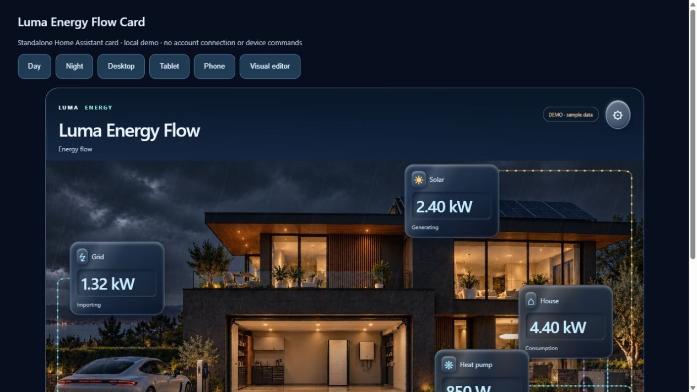

# Luma Energy Flow Card

A standalone Home Assistant dashboard card by **krystianokris**. A weather-aware house, animated energy flows, raised Glass Navy tiles and recessed readings. Built for desktop, tablet and phone.



## Current release · 0.1.1

- Six layouts: Classic House, Rings, River, Tiles, Overview and Schematic.
- Glass Navy and Clear Glass materials. House photographs remain visible in Classic and Rings.
- Optional solar, battery, EV, gas, heat pump and heating. Grid and house work without solar or storage.
- Visual entity, visibility, appearance and position editor. No YAML required for normal setup.
- Click a configured tile to open Home Assistant details/history. **Read-only:** no device switching or charging commands.
- Explicit demo mode with sample values and disabled entity actions.
- Day/night follows the configured sun entity (defaults to `sun.sun`). If unavailable, it uses 07:00–19:00 in the HA time zone, or UTC when HA provides none.
- Weather from a HA `weather` entity or a manual override: clear, cloudy, rain, storm, snow or fog. Manual weather still respects day/night.
- Six embedded **WebP** backgrounds: sunny/cloudy/rainy day and starry/cloudy/rainy night. Storm uses the rainy image with a subtle weather tint; snow and fog are visual overlays. No external image host is needed.
- Octopus Energy prices and costs in **GBP**, including negative electricity rates and pence conversion.
- HA data updates preserve tile and flow elements. Reduced-motion preferences are respected.

This early release has automated custom-element tests and a standalone browser preview. HACS installation and live grid/house/gas, Octopus and sun/weather readings have also been checked in a real HA dashboard. It is not yet part of the default HACS catalog.

## Install with HACS (custom repository)

1. In HACS open the three-dot menu → **Custom repositories**.
2. Add `https://github.com/krystianokris/luma-energy-flow-card` with category **Dashboard**.
3. Download **Luma Energy Flow Card** and reload your browser.
4. Check Settings → Dashboards → Resources. If HACS has not registered it automatically, add `/hacsfiles/luma-energy-flow-card/luma-energy-flow-card.js` as **JavaScript module**. Do not add duplicate resources.
5. Add a dashboard card and choose **Luma Energy Flow Card**. The initial picker example is DEMO; turn demo off and choose your own entities before relying on its readings.

The repository layout and generated filename follow the [HACS dashboard requirements](https://www.hacs.dev/docs/publish/plugin/).

## Manual installation

Download `luma-energy-flow-card.js` from the release and put it in `/config/www/luma-energy-flow-card.js`.
Add `/local/luma-energy-flow-card.js?v=0.1.1` as a JavaScript module resource, reload the browser, and add the card. The file includes all images and styles; no other assets need to be copied.

```yaml
type: custom:luma-energy-flow-card
title: Luma Energy Flow
demo: false
theme: navy
view: classic
lighting: auto
weather: weather.home
sun: sun.sun
entities:
  grid: sensor.grid_power
  home: sensor.house_power
```

Entity IDs above are placeholders. Use the visual editor to choose your own sensors.

## Data conventions

| Setting | Meaning / supported units |
| --- | --- |
| `grid` | Signed power: positive import, negative export. W/kW. |
| `home` | Total house power, including individual loads. W/kW. |
| `solar` | Positive generation. W/kW. |
| `battery` | Positive charging, negative discharging. W/kW. |
| `soc` | Battery percentage, clamped to 0–100. |
| `ev`, `heat_pump`, `heating` | Individual loads already included in house total. W/kW. |
| `gas` | Reported daily usage and original unit, including kWh or m³. |
| `rate`, `next_rate` | GBP/kWh, £/kWh, p/kWh, pence/kWh or GBPence/kWh. |
| `today_cost`, `gas_cost` | GBP, £, p, pence or GBPence. |
| `today_energy` | kWh or Wh. |

For split sensors, configure **both** `grid_import` + `grid_export`, or **both** `battery_charge` + `battery_discharge`. An incomplete pair gives no reading instead of assuming zero. `invert_grid` and `invert_battery` affect signed single sensors only. Unknown/unavailable values or unsupported power units display `—`; they are not treated as zero. Gas has no animated electrical flow.

Prices/costs are the values provided by your sensors. The card does not invent daily costs, include a standing charge automatically, or query Octopus directly. Configure integration sensors which contain the totals you want displayed.

## Layout and appearance

Set defaults in the HA card editor. Its **Position tiles** section selects any tile from a list and moves it with arrows or percentage X/Y, so an overlay never blocks selection of Grid or EV. Per-tile positions apply to Classic and Rings on larger screens; phones use an automatic two-column layout. Desktop default solar is positioned over the roof panels.

The small on-card gear provides a local preview of view, material and weather. These preview choices intentionally do not write dashboard configuration. Persist them through the normal HA card editor and **Save**.

```yaml
view: rings
theme: navy
weather_mode: auto
hidden: [ev, gas]
positions:
  solar: [70, 10]
  battery: [48, 82]
entities:
  solar: sensor.solar_power
  battery: sensor.battery_power
  soc: sensor.battery_percentage
```

Supported `view`: `classic`, `rings`, `river`, `tiles`, `overview`, `schematic`.
Supported `theme`: `navy`, `glass`. Language: `auto`, `en`, `pl` (card labels; the first-release editor is English).

Heat pump and heating require explicit entity configuration even in demo. They do not change the house total. Gas cost is displayed only when `gas_cost` is configured.

## Development

Requires Bun (tested with 1.4.0).

```sh
bun install --frozen-lockfile
bun test --preload ./test/setup.ts
bun run build
python -m http.server 8767 --bind 127.0.0.1
```

Open `http://127.0.0.1:8767/examples/demo.html` to preview layouts, weather, tablet/phone sizes and the visual editor. The demo contains sample entities only. Runtime has no external library dependencies. Happy DOM is a development-only test dependency. Build fails if all six WebP images are not embedded.

The custom element implements the [Home Assistant custom-card API](https://contributors.home-assistant.io/frontend/custom-ui/card/): `setConfig`, `hass`, card picker registration, visual editor, `getCardSize` and `getGridOptions`.

## Credits and license

MIT © 2026 Krystian (**krystianokris**). See [LICENSE](LICENSE).

The house-energy visualization concept was inspired by [mimikm/Home-Power-Flow-Card](https://github.com/mimikm/Home-Power-Flow-Card). This card is a separate implementation; no code from that repository is included and no endorsement is implied.

The house artwork was generated for this project family using OpenAI image generation and converted to WebP. See [ASSETS.md](ASSETS.md). No exclusive copyright in AI-generated imagery is claimed. HA, HACS and Octopus Energy are independent projects/services; this is a community card.
